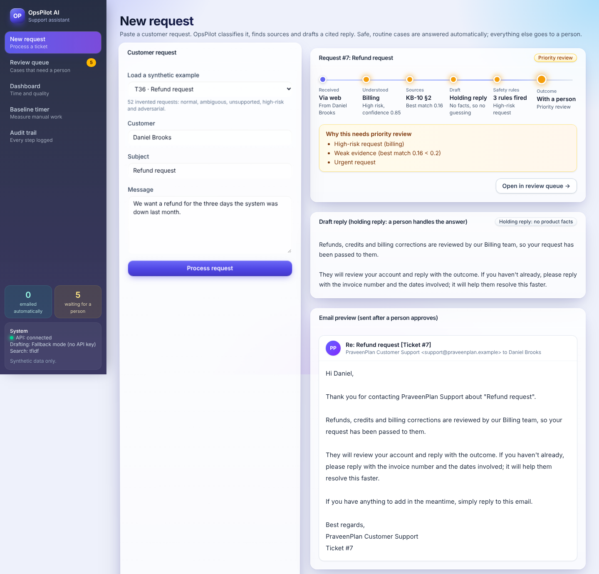
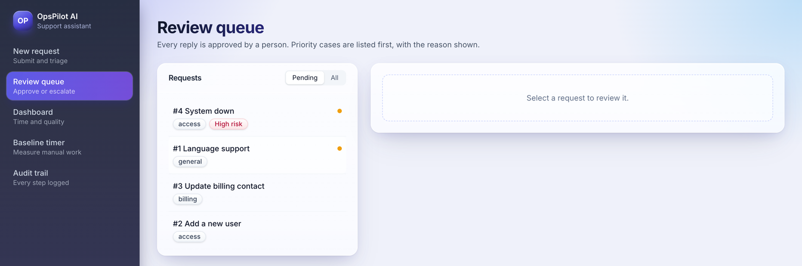
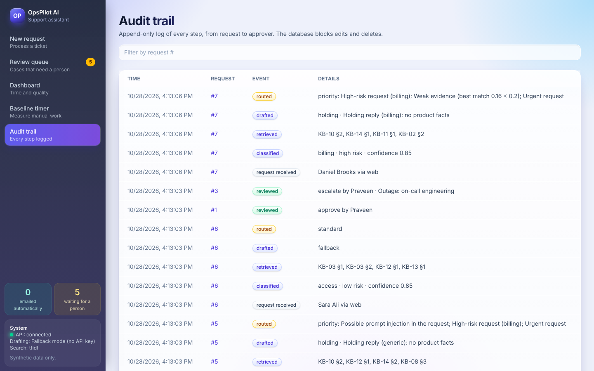
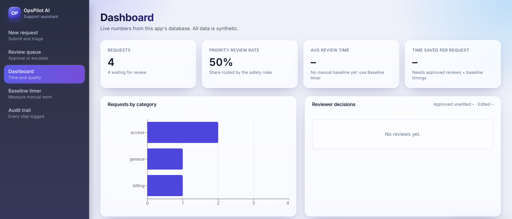

# OpsPilot AI

An assistant for support teams that answers routine customer tickets automatically from a knowledge
base, and hands everything risky or uncertain to a person, with the reasons.



I built this to explore a question that comes up whenever LLMs are used in customer support: how
do you get the speed of AI-drafted replies without letting the model make decisions it shouldn't?
OpsPilot splits the work. The model (or an offline fallback) reads and drafts. Plain, tested code
decides what is risky, checks that every claim points to a real source, and sends anything doubtful
to a person.

The screenshot above shows that split. The question "Is the interface available in French?" isn't
covered by the knowledge base, so confidence is low and the best match is weak. Instead of guessing,
OpsPilot writes no draft and routes the ticket to priority review, listing why.

**Live demo:** https://opspilot-ai-ugnm.onrender.com (free hosting: the first visit after a quiet
spell takes about a minute to wake up, and data resets on restart. Drafts there are written by
`openai/gpt-oss-120b` on Groq's free tier, capped at 200 calls a day.)

All data in this repo is synthetic. "LedgerGrid" is a made-up asset-accounting product, and its 14
help articles and 52 test tickets were written for this project. The numbers below describe the
prototype, not business results.

## How a ticket moves through the system

1. **Classify.** Category, urgency and risk, with a confidence score. Without an API key a keyword
   classifier runs. With one, an LLM classifies (Claude, or any OpenAI-compatible API such as Groq),
   but it can only raise the risk level, never lower it.
2. **Retrieve.** Hybrid search over the knowledge base: TF-IDF vectors in a FAISS index plus BM25,
   merged with reciprocal rank fusion. BM25 catches exact terms like error codes; the vector side
   catches paraphrases.
3. **Draft.** Every sentence ends with a source tag such as `[KB-07 §2]`. A guardrail checks in code
   that each tag points to a chunk that was actually retrieved, and flags commitments (refunds,
   dates, guarantees) that have no source.
4. **Route.** Seven rules choose between standard and priority review: possible prompt injection,
   high-risk request, low confidence (below 0.85), weak evidence, failed citation check, urgency,
   and an upset customer. The reviewer sees which rules fired.
5. **Auto-send or review.** A reply goes out with no person only if it passes nine checks: every
   review rule clear, low risk, no prompt injection, confidence at least 0.90, a strong source match,
   an LLM-written reply that passed the citation check, and a topic that isn't billing, data privacy,
   security, tax or general. Everything else waits for a person, who approves, edits, rejects or
   escalates. If the citation check failed, Approve stays locked until the reviewer confirms they
   checked the sources.
6. **Email.** The customer gets a professional email: greeting, the answer without source tags, the
   help articles it used, and a PraveenPlan Customer Support signature with the ticket number.
7. **Log.** Every step goes into an append-only audit table. SQLite triggers reject updates and deletes.

If any step throws an error, the ticket is not lost: it is logged and sent to priority review.

## Results

52 synthetic tickets, offline mode (no LLM). Reproduce with `python -m eval.run_eval`.

| Metric | Result |
|---|---|
| High-risk tickets sent to priority review | 100% |
| Drafts passing the citation check | 100% |
| Must-review tickets sent to priority review | 96.7% |
| Correct article in the top 3 search results | 90.6% |
| Category accuracy | 88.9% |
| Drafts written for questions the knowledge base can't answer | 13.3% |

Two caveats. The keyword classifier was written alongside this test set, so these numbers are
optimistic; real tickets will score lower. And there is one known silent failure: T29, an
out-of-scope question, is classified confidently enough to land in standard review. I left it in
rather than add a rule that exists only to pass one test. Every miss is listed in
[docs/eval_report.md](docs/eval_report.md).

## Screenshots

**Review queue.** Priority cases come first. "System down" is flagged high risk.



**Audit trail.** Each ticket's path from intake to routing, with the reasons recorded.



**Dashboard.** Live counts plus the latest evaluation run. Review time and time saved fill in once
reviews and manual baseline timings exist.



## Running it locally

You need Python 3.12 and Node 20 or later.

```bash
git clone https://github.com/PraveenKumarB-AI/opspilot-ai.git
cd opspilot-ai
python3.12 -m venv .venv && source .venv/bin/activate
pip install -r requirements-lock.txt
pytest -q
python -m eval.run_eval
uvicorn api.main:app --reload
```

In a second terminal:

```bash
cd frontend && npm install && npm run dev
```

Open http://localhost:5173 and load one of the sample tickets on the New request page. The API docs
are at http://localhost:8000/docs.

It runs fully offline. To use an LLM for classification and drafting, copy `.env.example` to `.env`
and either set `ANTHROPIC_API_KEY` (Claude) or set `OPSPILOT_LLM_PROVIDER=openai` and
`OPSPILOT_LLM_API_KEY` (Groq's free tier by default). The `.env` file is git-ignored.

To run the production build the way it's deployed (one service, UI and API together):
`cd frontend && npm run build && cd .. && uvicorn api.serve:app`, then open http://localhost:8000.
The `Dockerfile` does the same; it deploys as-is to Render's free tier.

## Project layout

```
api/         FastAPI app
opspilot/    pipeline: classifier, retriever, drafter, guardrails, router, database, metrics
eval/        evaluation script (writes docs/eval_report.md)
tests/       pytest suite
data/        synthetic knowledge base and test tickets
frontend/    React, Vite and Tailwind UI
docs/        user guide, demo script, evaluation report, development log
```

## How it was built

I built it in 13 modules with Claude Code, using a `CLAUDE.md` for project rules and approving every
edit by hand. After each module I asked for a review, checked each finding myself, wrote a failing
test before fixing anything, and recorded the outcome in [docs/dev_log.md](docs/dev_log.md),
including the suggestions I rejected and why. One example: a draft that had failed the citation
check could still be approved in one click, so Approve now needs an explicit confirmation.

## What I'd do next

- Run the evaluation on a sample of a real team's resolved tickets instead of synthetic ones.
- Build the manual baseline from ticket timestamps across several agents, not one stopwatch.
- Replace TF-IDF with sentence embeddings and re-tune the evidence threshold against the eval.
- Connect "send" to a ticketing system, with human review still required.

## License

MIT. See [LICENSE](LICENSE).
