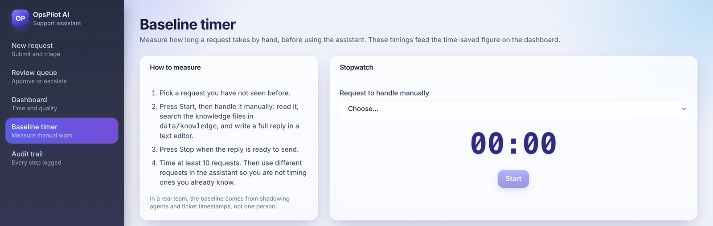

# Using OpsPilot AI

OpsPilot reads a customer request, finds the help articles that answer it, and drafts a reply with
sources. You approve every reply. Nothing goes out without you.

## Handling a new request

1. Open **New request**, paste the subject and message (or load a sample), and click **Process request**.
2. Check the category, risk, confidence and which review queue it went to.
3. Click **Open in review queue**.

If OpsPilot can't find a good answer, it writes no draft and says so. That's on purpose: a
specialist should handle those.

## Reviewing a draft

The card title tells you who wrote the draft: Claude, or the fallback, which copies sentences
straight from the help articles.

Each sentence ends with a tag like `[KB-07 §2]`. In **Sources**, the articles the draft cites are
highlighted and marked "cited in draft". Read the draft against them before you decide.

- **Approve and send.** If you changed the text, it is recorded as an edit automatically.
- **Reject draft.** The draft wasn't usable. Give a short reason.
- **Escalate to specialist.** Give a reason, for example "Refund: billing team".

If the citation check failed, a red box lists the problems and Approve stays locked until you tick
the confirmation box. If a colleague already handled the case, you'll see their decision instead of
overwriting it.

## Why a case is in priority review

Any one of these sends a case to priority review: the message tries to give the assistant
instructions; it's a high-risk request (refunds, credits, billing reversals, contracts, data
deletion, security, outages); classification confidence is low; the sources are weak; the citation
check failed; the request is urgent; or the customer is upset. The reasons are listed on the case.
For refunds, data deletion and security, follow team policy and escalate.

## Timing your manual baseline

Open **Baseline timer**, pick a request, press **Start**, handle it by hand (search the help
articles, write the reply), then press **Stop and save**. Time at least ten. The **Dashboard** uses
these to compare manual time with assisted review time.

## Audit trail

Every step is logged and can't be edited: received, classified, retrieved, drafted, routed,
reviewed, or pipeline error. Type a request number in the filter to see one case end to end.

## Who to ask

Thresholds, categories and routing rules: the support lead. Wrong or missing articles: the
knowledge base owner.
